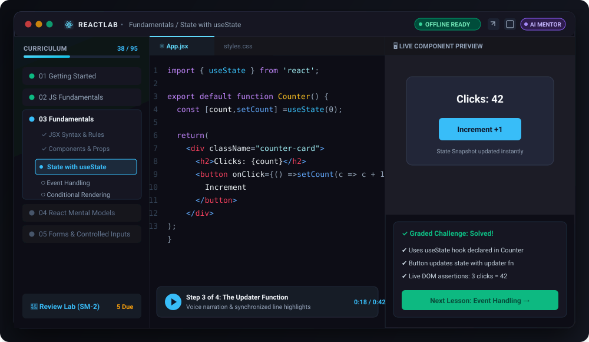
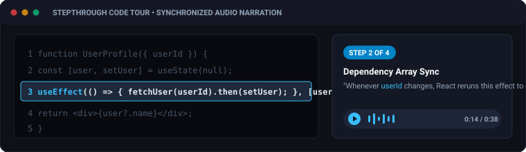
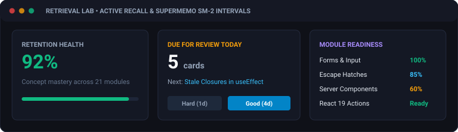
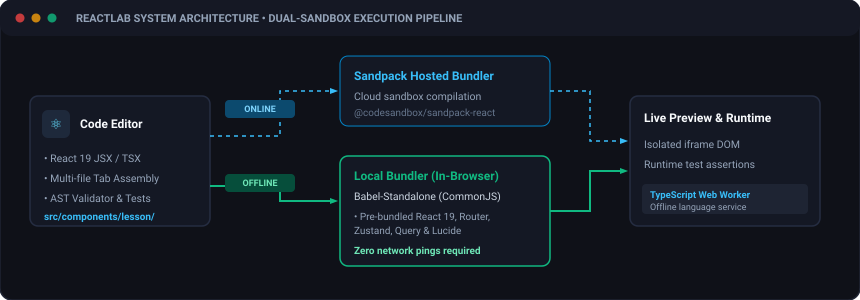

<div align="center">


# ReactLab

**An offline-first desktop interactive learning studio crafted for modern React**

*Master React 19 from mental models to production architectures — featuring 95 data-driven lessons, live Sandpack sandboxes, automated AST grading, and an offline AI tutor.*

<p>
  <a href="https://github.com/projectGloria/ReactLab"></a>
  
  
  
  
  
  
</p>

---

<p>
  <a href="#-about-reactlab">About</a> •
  <a href="#-key-features">Features</a> •
  <a href="#-visual-tour">Visual Tour</a> •
  <a href="#-curriculum-overview">Curriculum</a> •
  <a href="#-offline-first-architecture">Architecture</a> •
  <a href="#-quick-start">Quick Start</a> •
  <a href="#-building--packaging">Packaging</a> •
  <a href="#-repository-structure">Project Structure</a> •
  <a href="#-icon--design-philosophy">Design</a> •
  <a href="#-license--credits">License</a>
</p>

<picture>
  
</picture>

</div>

---

## ⚛️ About ReactLab

**ReactLab** is an offline-first desktop application designed to bridge the gap between reading React theory and developing true muscle memory. Built on **Electron**, **Vite**, and **React 19**, ReactLab packages a complete, guided engineering curriculum into a distraction-free local development studio.

Unlike conventional web tutorials that break the moment you go offline or rely on read-only examples, ReactLab treats your learning environment like a professional IDE:

- 💻 **Active Coding Over Passive Reading**: Every concept is taught alongside a runnable live sandbox. Inspect code, tweak state, break things, and explore solutions in real time.
- ⚡ **True Offline-First Independence**: All 95 lessons, step-by-step walkthroughs, challenge grading rules, and spaced-repetition schedules are saved locally. When offline, code sandboxes transparently switch to an embedded in-browser Babel bundler with zero network dependencies.
- 🧪 **Granular AST & Live DOM Grading**: Practice coding challenges validated by static Abstract Syntax Tree (AST) analysis (`acorn`, `acorn-jsx`) and automated DOM runtime assertions.
- 🎙️ **Synchronized Voice Walkthroughs**: Listen to step-by-step audio explanations synchronized with code line highlights, walking through both example playgrounds and challenge solutions.
- 🤖 **Private AI Mentorship**: Chat with Sonia, an AI tutor powered either entirely locally via **Ollama** (100% private, on-device) or through optional cloud providers (Gemini, OpenAI, Groq) via isolated Electron IPC.

---

## ✨ Key Features

<table>
  <tr>
    <td width="50%">
      <h3>⚡ Dual-Engine Code Sandboxes</h3>
      <p>Seamlessly compiles with <code>@codesandbox/sandpack-react</code> when online, and automatically falls back to an in-browser Babel CommonJS bundler with pre-bundled packages when offline.</p>
    </td>
    <td width="50%">
      <h3>🎓 95 Lessons Across 21 Modules</h3>
      <p>A rigorous, data-driven curriculum progressing linearly from JSX basics, hooks, and mental models to React 19 Actions (<code>useActionState</code>), Server Components, and full TypeScript.</p>
    </td>
  </tr>
  <tr>
    <td width="50%">
      <h3>🎙️ Synchronized Audio Walkthroughs</h3>
      <p>High-clarity voice-narrated walkthroughs guide you through code line-by-line, explaining pedagogical insights, pitfalls, and idiomatic modern React patterns.</p>
    </td>
    <td width="50%">
      <h3>🧠 Retrieval Lab (Spaced Repetition)</h3>
      <p>SuperMemo SM-2 interval scheduling with active recall checks, identifying shaky prerequisites and visualizing module readiness before advancing.</p>
    </td>
  </tr>
  <tr>
    <td width="50%">
      <h3>🤖 Local &amp; Cloud AI Tutor</h3>
      <p>Supervised Ollama daemon support for 100% private local LLMs, plus cloud provider integration (Gemini, OpenAI, Groq) guarded behind secure Electron IPC boundaries.</p>
    </td>
    <td width="50%">
      <h3>🪟 Detachable Multi-Window Studio</h3>
      <p>Modern frameless desktop window, detachable playground monitors for multi-display setups, customizable soundscapes, and distraction-free Zen mode.</p>
    </td>
  </tr>
</table>

---

## 📸 Visual Tour

### 1. Interactive StepThrough &amp; Synchronized Audio
Listen to narrated voice explanations while lines of code illuminate in real time. Deconstruct complex reactive flows without guessing.

<p align="center">
  
</p>

### 2. Retrieval Lab &amp; Spaced Repetition (SM-2)
Reinforce retention with active recall challenges. ReactLab calculates retention health and schedules timely review prompts before memories fade.

<p align="center">
  
</p>

### 3. Dedicated AI Voice Tutor "Sonia"
Need guidance on a difficult challenge? Sonia analyzes your current code editor state, test results, and lesson context to offer targeted hints without spoiling the answer.

<p align="center">
  
</p>

- **Local Supervisor**: Auto-manages local Ollama instances and models with configurable storage paths.
- **Secure Architecture**: API keys travel exclusively over IPC to the Electron main process; credentials never touch the renderer.
- **Pedagogical Alignment**: Configured with strict pedagogical guardrails to prompt critical thinking rather than writing code for you.

---

## 📚 Curriculum Overview

ReactLab’s 95 lessons are structured into 21 carefully ordered modules where each lesson builds strictly upon previously mastered concepts:

| Category | Modules | Covered Topics |
| :--- | :--- | :--- |
| **Foundations** | Modules 01 – 04 | JavaScript prerequisites, JSX syntax, Components, Props, State, Snapshot Rendering, Identity & Keys |
| **Forms & State** | Modules 05 – 08 | Controlled inputs, Client-side validation, <code>useRef</code>, <code>useReducer</code>, <code>useMemo</code>, <code>useEffect</code> synchronization & cleanup |
| **Architecture** | Modules 09 – 13 | Context API, Custom Hooks, Component Composition, Portals, Error Boundaries, React Router v7, Zustand, TanStack Query |
| **Modern React 19** | Modules 14 – 16 | Suspense, Concurrent Transitions, Server Components, <code>useActionState</code>, <code>useOptimistic</code>, React Compiler paradigms |
| **TypeScript & Tests** | Modules 17 – 20 | Generics, Narrowing, Typed Props & Hooks, React Testing Library, Mock Service Worker (MSW), Render diagnostics & A11y |
| **Capstones** | Module 21 | Full-scale integration projects: Fundamentals Dashboard, Production Client App, and Modern React Architecture |

> [!NOTE]
> ReactLab also includes bilingual support with Turkish language overlays (`src/curriculum/modules-tr/`) that keep code and grading character-identical while providing localized prose.

---

## ⚡ Offline-First Architecture

ReactLab guarantees that you can learn anywhere — on a flight, on a train, or off the grid.

<p align="center">
  
</p>

### How it works:

1. **Dual-Sandbox Preview**:
   - **Online**: Uses Sandpack’s hosted bundler for cloud-based transpilation.
   - **Offline**: Transparently activates `src/lib/localBundler.js`, running Babel Standalone inside an isolated iframe. Relative module imports and bare specifiers are resolved against `BUILTIN_MODULES` (React 19, React DOM, React Router, Zustand, TanStack Query, Lucide).
2. **Worker-Based TypeScript Diagnostics**:
   - Sandpack strips types with Babel to run code fast. To ensure genuine TypeScript errors are visible offline, `src/workers/typecheck.worker.js` runs a real `ts.createLanguageService` inside a Web Worker.
   - The TypeScript compiler, ES2020 standard libraries, and `@types/react` are bundled directly at build time.
3. **Zero-Network Invariant Enforcement**:
   - The curriculum validator (`validate-curriculum.mjs`) strictly ensures that every runnable example and starter code compiles and passes tests without remote dependencies.

---

## 🚀 Quick Start

### Prerequisites
- **Node.js** (v18.0.0 or higher recommended)
- **npm** (v9.0.0 or higher)

### 1. Clone & Install

```powershell
git clone https://github.com/projectGloria/ReactLab.git
cd ReactLab
npm install
```

### 2. Development

Run the browser-based Vite application:
```powershell
npm run dev
```

Or run the full desktop Electron application:
```powershell
npm run electron:dev
```

### 3. Automated Tests & Audits

Validate curriculum integrity, lesson invariants, and unit test suites:
```powershell
# Run Vitest test suite
npm test

# Enforce curriculum ordering, allowances, and lesson invariants
npm run validate:curriculum

# Audit line highlights and post-challenge walkthroughs
npm run audit:walkthroughs
```

---

## 📦 Building & Packaging

### Windows Desktop Build

Generate the application icon and package ReactLab for Windows:

```powershell
# Generate multi-resolution icon (build/icon.ico)
npm run icon

# Package NSIS Installer and Portable Windows Executable
npm run package:win
```

The compiled binaries will be output to:
```
release/
├── ReactLab Setup 1.0.0.exe   # Windows NSIS Installer
└── ReactLab 1.0.0.exe         # Portable Executable
```

Upon installation, ReactLab registers:
- Start Menu and Desktop shortcuts with high-resolution atom icons.
- Application data isolation under `%APPDATA%\ReactLab`.
- Automatic local Ollama process management.

---

## 📂 Repository Structure

```
ReactLab/
├── electron/                 # Electron main process, preload & Ollama supervisor
│   ├── main.cjs              # IPC endpoints, multi-window & mentor provider proxy
│   ├── ollamaSupervisor.cjs  # Managed local Ollama daemon lifecycle
│   └── preload.cjs           # Secure, isolated window.electronAPI bridge
├── public/
│   ├── audio/                # Narrated audio clips for walkthrough steps (.mp3)
│   ├── favicon.svg           # Application favicon
│   └── sonia-avatar.jpg      # AI tutor portrait asset
├── scripts/                  # CI validation, icon generator & audio manifest tools
│   ├── generate-icon.cjs     # Chromium-based multi-resolution ICO builder
│   ├── validate-curriculum.mjs# Strict curriculum invariant gatekeeper
│   └── audit-walkthroughs.mjs# Highlight line range and pedagogy auditor
├── src/
│   ├── assets/               # Branding graphics and logos
│   ├── components/           # UI components (Layout, Lesson, Mentor, Review)
│   ├── curriculum/           # Data-driven lessons, modules, and grading validators
│   │   ├── modules/          # 21 course modules (lessons, starter & solutions)
│   │   ├── modules-tr/       # Turkish language prose overlay
│   │   ├── index.js          # Single source of truth registry for modules
│   │   └── validators.js     # Per-lesson AST and DOM runtime test rules
│   ├── lib/                  # Bundlers, audio effects, soundscape & progression logic
│   │   ├── localBundler.js   # Offline Babel-standalone CommonJS bundler
│   │   └── progression.js    # Linear unlocking & prerequisite readiness scoring
│   ├── store/                # Zustand stores with localStorage persistence
│   └── workers/              # Inlined TypeScript Language Service worker
├── package.json              # Dependencies and build scripts
└── vite.config.js            # Vite configuration with playground HMR middleware
```

---

## 🎨 Icon & Design Philosophy

<p align="center">
  
</p>

> *"A dark charcoal squircle housing luminous cyan orbital rings, symbolizing reactivity, state synchronization, and focused technical precision."*

- **Obsidian Chassis**: A dark `#141413` backdrop engineered for deep visual comfort during long coding and debugging sessions.
- **Electric Cyan Orbitals**: Inspired by the iconic React atom mark, glowing with energy to signify reactive state updates and snapshot rendering.
- **Distraction-Free Workspace**: Streamlined typography, subtle mechanical keyboard audio feedback, and collapsible sidebars designed to keep your attention on code.

---

## 🛠️ Tech Stack

| Component | Technology | Description |
| :--- | :--- | :--- |
| **Desktop Shell** | [Electron 43](https://www.electronjs.org/) | Frameless multi-window desktop harness with isolated IPC |
| **UI Framework** | [React 19.2](https://react.dev/) | Modern client UI utilizing latest hooks, transitions, and Actions |
| **Bundler & Dev** | [Vite 8](https://vitejs.dev/) | Ultra-fast HMR dev server and optimized asset pipeline |
| **Sandboxes** | [Sandpack](https://sandpack.codesandbox.io/) + [Babel](https://babeljs.io/) | Dual online/offline reactive browser execution engines |
| **State** | [Zustand 5](https://zustand-demo.pmnd.rs/) | Lightweight persisted client stores with sync-external-store safety |
| **Styling & Motion** | [Framer Motion](https://www.framer.com/motion/) + CSS | Fluid panel transitions, modal dialogs, and smooth micro-interactions |
| **Code Analysis** | [Acorn](https://github.com/acornjs/acorn) + [TypeScript](https://www.typescriptlang.org/) | AST challenge grading and Web Worker TypeScript compiler diagnostics |
| **Icons** | [Lucide React](https://lucide.dev/) | Clean, consistent developer iconography |
| **Testing** | [Vitest 3](https://vitest.dev/) | Fast unit testing and automated curriculum invariant gates |

---

## 📜 License & Credits

ReactLab is open-source software distributed under the **[MIT License](LICENSE)**.

- **Curriculum & Application Architecture**: Built with care for developers seeking deep, intuitive React mastery.
- **Third-Party Libraries**: All bundled packages, dependencies, and tools remain the intellectual property of their respective maintainers.
